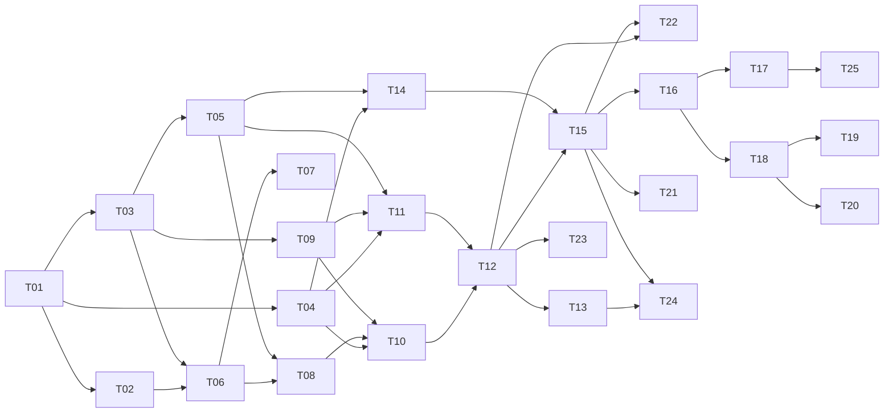

# 12 — Delivery plan

Tickets are sized for **one PR each** (≈ 0.5–2 days of human work) so a factory agent can
implement them independently. Full ticket text: `factory/issues/Txx-*.md`; dependencies in
`factory/issues.json`. They are imported as GitHub issues with *blocked by* relations; a ticket
gets the `tessl` label automatically once all its blockers are closed (see `factory/README.md`).

## Milestones

| Milestone | Outcome | Tickets |
|-----------|---------|---------|
| **M0 Foundations** | Repo, DB, shared libs, engine port with parity tests | T01–T05 |
| **M1 Web basics** | Sign-in, users, projects & settings in UI | T06–T08 |
| **M2 Capture** | Sitemap + capture runs on Cloudflare with live progress | T09–T13 |
| **M3 Compare** | Comparisons, diff container, report viewer, share links | T14–T17 |
| **M4 Review** | Approve/reject/ignore, ignore rules, baseline, review memory | T18–T20 |
| **M5 Ops & release** | Notifications, storage, legacy import, admin, hardening, acceptance | T21–T26 |
| **M6 Later** | Scheduled runs (cron per project via Workflows/Cron Triggers), retention automation, CLI on top of engine | not ticketed |

## Ticket list & dependencies

| ID | Title | Depends on |
|----|-------|-----------|
| T01 | Monorepo scaffold, tooling, CI | — |
| T02 | Supabase schema, RLS, seed, types | T01 |
| T03 | Shared package: contracts, env, crypto, HMAC, R2 keys | T01 |
| T04 | Engine package: port prototype logic with parity tests | T01 |
| T05 | Storage package: R2 S3 client + bucket admin | T03 |
| T06 | Web app skeleton + Supabase auth | T02, T03 |
| T07 | Invitations, members, admin users | T06 |
| T08 | Projects CRUD, settings, viewports, .env import, bucket check | T06, T05 |
| T09 | Worker scaffold, HMAC API, deploy pipeline | T03 |
| T10 | Sitemap workflow + sitemap UI | T04, T08, T09 |
| T11 | Browser Rendering capture consumer + limiter | T04, T05, T09 |
| T12 | Capture run workflow, run API, cancel/retry | T10, T11 |
| T13 | Runs UI with realtime progress | T12 |
| T14 | Diff container | T04, T05 |
| T15 | Compare workflow, diff consumer, files & redirects | T12, T14 |
| T16 | Report UI and item viewer | T15 |
| T17 | Static export, signed URLs, share links | T16 |
| T18 | Review actions, bulk, baseline, keyboard | T16 |
| T19 | Ignore rules end-to-end | T18 |
| T20 | Review memory (auto-approve) | T18 |
| T21 | Notifications (email + Slack) | T15 |
| T22 | Storage page + delete workflow | T12, T15 |
| T23 | Legacy import of prototype runs | T12 |
| T24 | Audit log + job health admin | T13, T15 |
| T25 | Security hardening | T17 |
| T26 | Staging smoke test, release acceptance, runbook | all |

Parallelism: after T01, the factory can run T02/T03/T04 simultaneously; after M1, T09/T11/T14
in parallel.

## Manual steps for the product owner (not for agents)

1. GitHub repo (exists), Vercel project (root `apps/web`), Supabase project, Cloudflare Workers Paid plan
   with Browser Rendering, Workflows, Queues and Containers enabled.
2. Create R2 S3 API token (Object Read & Write) and CF API token (Workers R2 Storage: Edit, plus
   Workers Scripts/Queues/Containers edit for deploys).
3. Set secrets in Vercel, GitHub Actions (for wrangler deploy) and Tessl environment (for tests:
   only local/dev values — agents run against local Supabase, never production).
   Import the tickets: `node specification/factory/import-issues.mjs`.
4. Configure Supabase Auth: site URL, redirect URLs (Vercel preview pattern), Google OAuth (optional), SMTP or Resend.
5. Run `pnpm seed:admin <your-email>` once on production.
